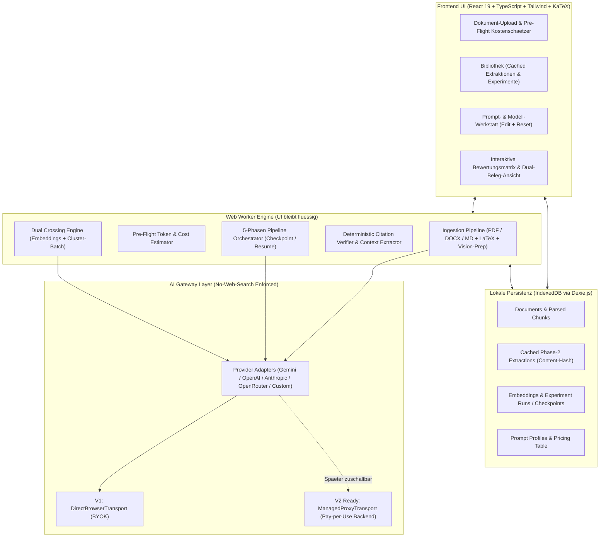
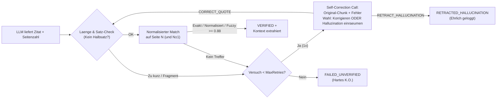

# Softwarearchitekturplan & Umsetzungs-Roadmap: BioBridge (Bionik-Kreuzungslabor)

> **Status:** `V1_IMPLEMENTED — ALL AUTOMATED CHECKS GREEN (95/95 TESTS, BUILD & EVAL PASS)`
> **Bezugsdokument:** [konzeptdokument_bionik_kreuzungslabor.md](konzeptdokument_bionik_kreuzungslabor.md)
> **Zielgruppe dieses Plans:** Umsetzende KI-Agenten und Entwickler (nahtloses Handover, inkrementelle Umsetzung, prüfbare Meilensteine)
> **Letzte Aktualisierung:** 2026-11-19

---

## 0. Leitprinzipien & Nicht-Verhandelbare Regeln (Non-Negotiables)

Jeder Agent, der an diesem Repository arbeitet, muss folgende unveränderliche Systeminvarianten einhalten:

1. **Epistemische Hygiene & Kein Internet-Zugriff durch LLMs:** Die KI nutzt ihr trainiertes physikalisches, biologisches und technisches Wissen für Abstraktion, Skalierungsprüfungen und Neuheitsbewertung — **Web-Search, Search-Grounding und externe Internet-Tools sind auf Adapter-Ebene strikt deaktiviert und per Test abgesichert.**
2. **Strikte Blind-Extraktion & Rollen-Isolation:** Phase 2 analysiert Domäne A (Biologie) und Domäne B (Technik) vollständig getrennt ohne Kenntnis der jeweils anderen Seite. Phase 4 (*Advocatus Diaboli*) läuft in einem isolierten Kontext ohne den Gesprächsverlauf von Phase 3 (*Ideengeber*).
3. **Deterministische Belegpflicht mit Self-Correction:** Kein Zitat wird blind geglaubt. Jedes Originalzitat wird programmatisch gegen den geparsten Quelltext geprüft. Bei Fehlschlag gibt es einen kontrollierten Korrekturversuch mit expliziter Wahl zwischen korrigiertem, kontextvollständigem Zitat oder ehrlichem Eingeständnis einer Halluzination (`RETRACTED_HALLUCINATION`).
4. **Sachbuch-Fähigkeit ab V1:** Alle Parser, Chunking-Routinen, Queues, Persistenz-Layer und Crossing-Strategien müssen mit mehreren hundert Seiten pro Dokument (z. B. 4 Sachbücher parallel) stabil, speicherschonend und ohne Einfrieren der UI laufen.
5. **Volle Kostentransparenz vor Start:** Vor dem ersten bezahlten API-Aufruf erhält der Nutzer eine detaillierte, live aktualisierte Token- und Kostenschätzung (Min / Erwartet / Max) inkl. optionalem hartem Budget-Stopp.
6. **Transparenz für kluge Nicht-Techniker:** Alle Systemprompts und Parameter sind in der App einsehbar, verständlich erklärt, editierbar (mit Schutz des technischen JSON-Vertrags) und per 1-Klick auf Standard zurücksetzbar.
7. **Option A jetzt, Option B sauber vorbereitet:** V1 läuft als statische Client-Side-Web-App (BYOK). Alle KI-Aufrufe laufen über ein abstrahiertes `TransportAdapter`-Interface, damit später ohne Umbau der Pipeline ein Managed-API-Proxy mit Pay-per-Use-Abrechnung (Option B) zugeschaltet werden kann.

### Arbeitsanweisung für umsetzende KI-Agenten
- Lies vor Arbeitsbeginn immer diesen Plan **und** den Abschnitt **10. Fortschritts- & Handover-Log** am Ende.
- Arbeite Meilensteine in Reihenfolge (`M0` → `M8`) ab. Markiere erledigte Aufgaben mit `[x]`.
- Schreibe zu jedem neuen Modul unmittelbar Unit-/Integrationstests; ein Meilenstein gilt erst als abgeschlossen, wenn seine **Definition of Done (DoD)** grün ist.
- Dokumentiere Abweichungen, entdeckte Bugs oder geänderte Entscheidungen sofort in Abschnitt 10.

---

## 1. Systemarchitektur (High-Level)

BioBridge ist in V1 eine **Local-First Single-Page-Application (SPA)** mit ausgelagerter **Web-Worker-Rechenschicht**, **IndexedDB-Persistenz** und einer **austauschbaren KI-Transport-Schicht**.



---

## 2. Architekturentscheidungen (ADRs)

| ADR | Entscheidung | Begründung & Trade-offs |
| :--- | :--- | :--- |
| **ADR-01** | **Frontend Stack: TypeScript (strict) + React 19 + Vite + Tailwind CSS + Radix UI** | Breites Ökosystem, erstklassige TypeScript-Unterstützung, nahtloser Pfad zu Tauri in Stufe 2, barrierefreie UI-Primitives (Dialoge, Tooltips, Slider) für Nicht-Techniker. |
| **ADR-02** | **Ausführung von Parsing, Matching & Pipeline im Web Worker** | 4 Sachbücher (1.500+ Seiten) blockieren sonst den Main-Thread. Typisierte RPC-Kommunikation über `comlink` oder strikt typisierte Worker-Events; UI erhält reine Progress-/Ledger-Events. |
| **ADR-03** | **Client-Side Multi-Format Ingestion (`pdfjs-dist`, `jszip`+XML, `remark`)** | Unterstützt `.pdf`, `.docx`, `.md` (und `.txt`) ohne Server-Upload. PDF nutzt eigene spaltenbewusste Layout-Rekonstruktion (XY-Cut) statt naivem Text-Join. |
| **ADR-04** | **Hybrid LaTeX- & Diagramm-Verarbeitung + KaTeX-Rendering** | `.md` und `.docx` (OMML `m:oMath` → LaTeX) werden deterministisch konvertiert. In PDFs erkennen Heuristiken Math-Fonts/Symbol-Cluster und Bilder; nur betroffene Seiten werden (je nach Nutzer-Setting) per Canvas gerendert und per Vision-LLM in LaTeX/Diagramm-Beschreibungen übersetzt. |
| **ADR-05** | **Lokale Persistenz via IndexedDB (`Dexie.js`) + Content-Addressing (SHA-256)** | Große Dokumente & Vektoren überschreiten `localStorage`-Limits. Content-Hash + Config-Hash ermöglichen 100 % sichere Wiederverwendung bereits extrahierter Bücher in neuen Kreuzungen sowie lückenloses Pause/Resume. |
| **ADR-06** | **Provider- & Transport-Trennung (`ProviderAdapter` × `TransportAdapter`)** | Trennt Anbieter-Protokoll (Gemini, OpenAI, Anthropic, OpenRouter, OpenAI-kompatibel) vom Netzwerk-/Abrechnungsweg (`DirectBrowserTransport` für V1 BYOK vs. `ManagedProxyTransport` für V2 Option B). Deaktiviert Web-Search/Grounding zentral. |
| **ADR-07** | **Zod-Single-Source-of-Truth & Split-Prompt-Architektur** | Zod-Schemas generieren TS-Typen, JSON-Schemas für LLM Structured Outputs und Laufzeitvalidierung (inkl. Auto-Repair bei fehlerhaftem JSON). Editierbare Nutzer-Instruktionen sind strikt getrennt vom unveränderlichen Ausgabe-Schema-Vertrag. |
| **ADR-08** | **Deterministische Zitat-Verifikation + 1× Self-Correction/Retraction-Loop** | Verhindert halluzinierte Belege zuverlässiger als reine LLM-Prüfung. Prüft Mindestkontext (keine isolierten Halbsätze), normalisiert PDF-Artefakte und erlaubt 1 ehrlichen Korrektur- oder Rückzugsversuch. |
| **ADR-09** | **Dual Crossing Engine (`ICrossingStrategy`)** | Implementiert sowohl **Hybrid-Embedding-Vorauswahl** als auch **Thematisches Clustering + Batch-Kreuzung** hinter einem gemeinsamen Interface. Nutzer wählt frei mit verständlicher In-App-Empfehlung. |
| **ADR-10** | **Pre-Flight Cost Estimator + Budget-Circuit-Breaker** | Berechnet vor Laufstart `min / expected / max` Tokens & Kosten pro Phase (inkl. Cache-Ersparnis & Vision-Seiten) auf Basis einer editierbaren Modell-Preisliste. Ein optionales Budget-Limit stoppt die Pipeline sauber am nächsten Checkpoint. |

---

## 3. Ziel-Verzeichnisstruktur

```text
BionikMatch/
├── .plans/
│   ├── konzeptdokument_bionik_kreuzungslabor.md
│   └── architekturplan_biobridge.md
├── docs/
│   └── option_b_proxy_contract.md        # OpenAPI / HTTP-Spec für späteres Managed-Pay-per-Use-Backend
├── eval/                                 # Automatisierbares Kalibrierungs- & Benchmark-Harness
│   ├── datasets/
│   │   ├── positive_ants_autoscaling.json
│   │   ├── known_classic_aco_routing.json
│   │   ├── metaphor_trap_queen_master.json
│   │   └── distant_domain_calibration.json
│   ├── run-eval.ts                       # CLI Runner (Vitest / tsx) für Prompt- & Filter-Metriken
│   └── README.md
├── src/
│   ├── main.tsx
│   ├── App.tsx
│   ├── core/                             # Reine Domänentypen, Zod-Schemas & Konstanten (Zero UI/IO)
│   │   ├── schemas/
│   │   │   ├── document.schema.ts        # SourceDocument, ParsedPage, ParsedBlock, DocumentChunk
│   │   │   ├── extraction.schema.ts      # ExtractedMechanism (A), ExtractedProblem (B), Citation
│   │   │   ├── crossing.schema.ts        # CrossingCandidate, ClusterSummary
│   │   │   ├── review.schema.ts          # CriticReview, ScoreBreakdown, VerdictStatus
│   │   │   ├── experiment.schema.ts      # ExperimentRun, RunConfig, Checkpoint, CostLedger
│   │   │   ├── prompt.schema.ts          # PromptProfile, PromptTemplateSlot
│   │   │   └── export.schema.ts          # BioBridgeProjectBundle (.biobridge.json)
│   │   ├── scoring/
│   │   │   └── deterministicRules.ts     # Harte K.O.-Regeln, Score-Deckelung, Gewichtungsrechner
│   │   └── utils/
│   │       ├── hash.ts                   # SHA-256 (Web Crypto API)
│   │       └── textNormalize.ts          # Unicode NFKC, Ligaturen, Silbentrennung
│   ├── ingestion/                        # Phase 1: Multi-Format Parsing, LaTeX, Vision-Prep, Chunking
│   │   ├── ingestionRouter.ts
│   │   ├── pdf/
│   │   │   ├── pdfParser.ts              # pdfjs-dist Wrapper
│   │   │   ├── columnLayout.ts           # XY-Cut / Spalten-Sortierung + Header/Footer-Filter
│   │   │   ├── mathAndFigureDetector.ts  # Erkennt kaputte PDF-Formeln & Grafik-Regionen
│   │   │   └── pageRenderer.ts           # OffscreenCanvas/Canvas PNG/WebP Export für Vision-Calls
│   │   ├── docx/
│   │   │   ├── docxParser.ts             # JSZip + word/document.xml Parser + Tabellen + Bilder
│   │   │   └── ommlToLatex.ts            # Konvertiert Word-Formeln (m:oMath) nach LaTeX
│   │   ├── markdown/
│   │   │   └── markdownParser.ts         # remark + remark-math + remark-gfm + Abschnitts-Anker
│   │   └── chunker.ts                    # Hierarchisches, satzgrenzen- & seiten-bewusstes Chunking
│   ├── estimation/                       # Pre-Flight Token-, Zeit- & Kostenschätzung
│   │   ├── tokenizer.ts                  # Schnelle Token-Zählung (BPE-Heuristik / cl100k-nah)
│   │   ├── pricingCatalog.ts             # Standard-Modellpreise + Nutzer-Overrides
│   │   └── costEstimator.ts              # Min/Expected/Max pro Phase inkl. Cache-Hits & Vision
│   ├── prompts/                          # Standard-Systemprompts & Template-Engine
│   │   ├── defaults/
│   │   │   ├── extractBio.prompt.ts
│   │   │   ├── extractTech.prompt.ts
│   │   │   ├── visionExtract.prompt.ts   # Diagramme + PDF-Formel-Rekonstruktion in LaTeX
│   │   │   ├── consolidate.prompt.ts     # Deduplizierung über Kapitel ganzer Bücher
│   │   │   ├── crossing.prompt.ts        # Ideengeber (Phase 3)
│   │   │   ├── cluster.prompt.ts         # Themen-Clustering (Phase 3B)
│   │   │   ├── critic.prompt.ts          # Advocatus Diaboli (Phase 4)
│   │   │   └── citationRepair.prompt.ts  # Self-Correction / Retraction Loop
│   │   ├── promptCompiler.ts             # Kombiniert User-Instruktion + geschützten Schema-Vertrag
│   │   └── promptValidator.ts            # Prüft Pflichtvariablen & warnt vor kaputten Edits
│   ├── ai/                               # Provider- & Transport-Layer (No-Web-Search)
│   │   ├── types.ts                      # IAIProvider, ITransportAdapter, LLMRequest, UsageReceipt
│   │   ├── transports/
│   │   │   ├── directBrowserTransport.ts # V1: BYOK direkt aus Browser
│   │   │   └── managedProxyTransport.ts  # V2-Vorbereitung: Pay-per-Use Gateway + Billing-Hooks
│   │   ├── providers/
│   │   │   ├── geminiAdapter.ts
│   │   │   ├── openaiAdapter.ts          # Deckt OpenAI, OpenRouter & OpenAI-kompatible (Ollama) ab
│   │   │   ├── anthropicAdapter.ts
│   │   │   └── providerRegistry.ts
│   │   ├── structuredOutput.ts           # Zod-Validierung + automatischer JSON-Repair-Retry
│   │   └── rateLimitQueue.ts             # Concurrency, Token-Bucket, 429-Backoff, Pause/Abort
│   ├── verification/                     # Deterministische Zitat- & Kontextprüfung
│   │   ├── citationVerifier.ts           # Exact → Normalized → Fuzzy-Window Matching + Mindestkontext
│   │   └── selfCorrectionHandler.ts      # 1× gezielter Korrektur- oder Rückzugs-Loop
│   ├── pipeline/                         # 5-Phasen-Orchestrierung & Crossing-Strategien
│   │   ├── orchestrator.ts               # State-Machine mit Checkpoint/Resume & Budget-Guard
│   │   ├── phases/
│   │   │   ├── phase1VisionEnrich.ts     # Optionale Vision-Analyse für markierte Seiten/Bilder
│   │   │   ├── phase2BlindExtract.ts     # Isolierte Extraktion A & B + Buch-Konsolidierung
│   │   │   ├── phase3CrossEngine.ts      # Dispatcher für Strategie A / B
│   │   │   └── phase4CriticReview.ts     # Isolierter Advocatus Diaboli + deterministische K.O.-Regeln
│   │   └── strategies/
│   │       ├── crossingStrategy.interface.ts
│   │       ├── embeddingHybridStrategy.ts # Vektor-Ähnlichkeit + Kreativitäts-Band + MMR
│   │       └── clusterBatchStrategy.ts    # Thematische Cluster + systematische Cluster-Kreuzung
│   ├── storage/                          # Lokale Persistenz & Export/Import
│   │   ├── db.ts                         # Dexie.js Datenbank-Definition & Migrationen
│   │   ├── repositories/
│   │   │   ├── documentRepo.ts
│   │   │   ├── extractionCacheRepo.ts    # Content-Hash + Config-Hash Lookup
│   │   │   ├── experimentRepo.ts         # Runs, Checkpoints, Candidates, Reviews
│   │   │   └── settingsRepo.ts           # PromptProfiles, ModelConfig, PricingOverrides
│   │   └── exporters/
│   │       ├── markdownExporter.ts
│   │       ├── csvExporter.ts
│   │       └── projectBundleIo.ts        # Export & Import (.biobridge.json)
│   ├── workers/
│   │   ├── pipeline.worker.ts            # Führt Ingestion + Pipeline + Verifikation off-main-thread aus
│   │   └── workerClient.ts               # Typisierte Bridge für React/Zustand
│   ├── state/
│   │   └── appStore.ts                   # Zustand Store für aktiven Run, Progress, Filter, Modals
│   └── ui/                               # Benutzeroberfläche
│       ├── layout/                       # AppShell, Navigation, CostTicker, BudgetAlert
│       ├── components/
│       │   ├── MathText.tsx              # Markdown + KaTeX Inline/Block Renderer
│       │   ├── CitationBadge.tsx         # Verifikationsstatus + Tooltip
│       │   ├── InfoPopover.tsx           # Klartext-Erklärungen für Nicht-Techniker
│       │   └── ModelSelector.tsx         # Rollen-spezifische Modellwahl
│       └── features/
│           ├── setup/                    # Dual-Dropzones, Diagramm/Formel-Toggle, Strategie-Karten, Cost-Preview
│           ├── library/                  # Gecachte Bücher/Paper + Wiederverwenden in neuem Lauf
│           ├── runner/                   # Live-Phasen-Fortschritt, Pause/Resume, Audit-Log
│           ├── matrix/                   # Sortier-/Filter-Matrix, Dual-Beleg-Drawer, Exports
│           └── settings/                 # API-Keys / Option-B-Modus, Prompt-Werkstatt (Diff+Reset), Preisliste
├── tests/                                # Unit- & Integrations-Tests (Vitest)
├── package.json
├── tsconfig.json
└── vite.config.ts
```

---

## 4. Kern-Datenmodell & IndexedDB-Schema

### 4.1 Zentrale Domänen-Entitäten (Kurzspezifikation für Zod-Schemas)

1. **`SourceDocument`**
   - `id`, `domain: 'biology' | 'technology'`, `fileName`, `mimeType`, `format: 'pdf' | 'docx' | 'md' | 'txt'`
   - `contentHash: string` (SHA-256 der Rohdatei), `fileSizeBytes`, `pageCount`, `detectedLanguage`
   - `stats`: `{ totalChars, estimatedTokens, detectedFigurePages: number[], detectedMathAnomalyPages: number[] }`
   - `createdAt`

2. **`ParsedPage` & `ParsedBlock`**
   - `pageNumber: number` (bei Markdown/DOCX ohne feste Seiten: deterministische Abschnitts-/Pseudo-Seitennummer + exakter `sectionPath`)
   - `sectionPath: string[]` (z. B. `["Kapitel 4: Arbeitsorganisation", "4.2 Lokale Interaktionsraten"]`)
   - `rawNormalizedText: string` (Basis für deterministische Zitat-Verifikation!)
   - `blocks: Array<{ id, type: 'paragraph' | 'heading' | 'table' | 'formula' | 'figure_vision', content: string, latex?: string, figureRef?: string }>`

3. **`Citation` (Verifiziertes Belegobjekt)**
   - `documentId`, `documentTitle`, `pageNumber`, `sectionPath: string`
   - `quoteOriginal: string` (exaktes Zitat in **Originalsprache**; min. 1 vollständiger Satz bzw. ≥ 40 Zeichen, bis ~1.200 Zeichen erlaubt)
   - `quoteTranslation?: string` (optional, falls Dokument-Sprache ≠ Ausgabesprache)
   - `contextBefore: string`, `contextAfter: string` (automatisch aus dem Quelltext extrahiert, ca. 200–300 Zeichen)
   - `verification`:
     - `status: 'VERIFIED_EXACT' | 'VERIFIED_NORMALIZED' | 'VERIFIED_FUZZY' | 'CORRECTED_VERIFIED' | 'RETRACTED_HALLUCINATION' | 'FAILED_UNVERIFIED'`
     - `matchScore: number` (0..1)
     - `matchedPageNumber: number` (erlaubt ±1 Seite bei Seitenumbruch-Zitaten)
     - `attempts: number` (1 oder 2)
     - `retractionReason?: string`

4. **`ExtractedMechanism` (Domäne A — SAPPhIRE-/BioTRIZ-inspiriert)**
   - `id`, `sourceDocumentIds: string[]` (nach Buch-Konsolidierung ggf. mehrere Kapitel/Dokumente)
   - `title`, `biologicalSystem` (Organismus/Teilsystem)
   - `structure` (anatomische/organisatorische Struktur)
   - `workingPrinciple` (formalisierbare Wirklogik / Kausalregel, inkl. LaTeX-Formeln falls vorhanden)
   - `achievedEffect` (funktionaler Effekt, sprachneutral abstrahiert)
   - `boundaryConditions`: `{ spatialScale, timeScale, medium, energyForm, operatingConstraints, faultTolerance }`
   - `functionalAbstract`: `string` (kompakte domänenneutrale Beschreibung — Input für Embeddings & Matching)
   - `citations: Citation[]` (mind. 1 verifiziertes Zitat)

5. **`ExtractedProblem` (Domäne B)**
   - `id`, `sourceDocumentIds: string[]`
   - `title`, `technicalDomain`
   - `problemStatement`, `coreBottleneck`, `targetMetrics`, `currentApproachesAndLimits`
   - `boundaryConditions`: `{ spatialScale, timeScale, medium, energyForm, operatingConstraints, reliabilityRequirements }`
   - `functionalNeedAbstract`: `string` (domänenneutrale Funktionsanforderung — Gegenstück zu `functionalAbstract`)
   - `citations: Citation[]`

6. **`CrossingCandidate` (Phase 3 Output)**
   - `id`, `experimentId`, `mechanismId`, `problemId`
   - `strategyUsed: 'embedding-hybrid' | 'cluster-batch'`
   - `similarityScore?: number` (bei Embedding-Strategie), `distanceBand?: 'strict' | 'balanced' | 'exploratory'`
   - `bridgeTitle`, `abstractTransferLogic`, `proposedImplementationSketch`, `keyAssumptions: string[]`, `potentialFailureModes: string[]`
   - `mechanismCitationIds`, `problemCitationIds`

7. **`CriticReview` (Phase 4 Advocatus Diaboli Output)**
   - `candidateId`, `criticModelUsed`
   - `scores`:
     - `mechanismDepth: 0 | 1 | 2 | 3`
     - `scalabilityAndConstraints: 0 | 1 | 2 | 3`
     - `technicalValue: 0 | 1 | 2`
     - `novelty: 0 | 1 | 2`
     - `evidenceQuality: 'PASS' | 'KO'` (wird zusätzlich deterministisch durch `Citation.verification.status` erzwungen!)
   - `weightedTotalScore: number` (Standard 0–10; berücksichtigt optionale Nutzer-Gewichtungen)
   - `status`: `'PROMISING' | 'NEEDS_CHECK' | 'KNOWN_STANDARD' | 'REJECTED_METAPHOR' | 'REJECTED_SCALING' | 'REJECTED_EVIDENCE' | 'RETRACTED'`
   - `scalingWarning?: string`
   - `knownPriorArt?: string`
   - `criticalCounterarguments: string[]` (**Pflichtfeld, min. 1 substanzieller Eintrag**, auch bei 8–10 Punkten!)
   - `openHurdles: string[]`
   - `verdictSummary: string`

8. **`ExperimentRun` & `PipelineCheckpoint`**
   - `id`, `name`, `createdAt`, `updatedAt`, `status: 'DRAFT' | 'ESTIMATED' | 'RUNNING' | 'PAUSED' | 'BUDGET_STOPPED' | 'COMPLETED' | 'FAILED'`
   - `biologyDocIds: string[]`, `technologyDocIds: string[]`
   - `config`: `{ outputLanguage, crossingStrategy, creativityDistance, maxCandidates, includeDiagrams, pdfMathVisionMode, modelAssignments, weights, budgetLimitUsd?, promptProfileSnapshot }`
   - `checkpoint`: `{ currentPhase, completedChunkKeys: string[], completedPairKeys: string[], completedReviewKeys: string[], lastError? }`
   - `costEstimate: CostEstimate`, `costLedger: CostLedger` (reale verbrauchte Input/Output/Vision/Embedding-Tokens & Kosten)

### 4.2 IndexedDB-Tabellen (`Dexie.js`)

| Tabelle | Primärschlüssel & Indizes | Zweck |
| :--- | :--- | :--- |
| `documents` | `id, &contentHash, domain, createdAt` | Metadaten hochgeladener Dokumente |
| `parsedPages` | `[documentId+pageNumber], documentId` | Geparster Volltext + Blöcke pro Seite (für Verifier & Chunking) |
| `extractionCaches` | `cacheKey, documentId, domain, contentHash, createdAt` | Gecachte Phase-2-Ergebnisse (`cacheKey = sha256(contentHash + extractionConfigHash + promptHash + outputLanguage)`) |
| `embeddings` | `[itemId+modelId], cacheKey` | Gecachte Vektoren (Float32Array) für Phase 3A |
| `experiments` | `id, status, updatedAt` | Experiment-Konfiguration, Prompt-Snapshot, Checkpoints & Cost-Ledger |
| `candidates` | `id, experimentId, [experimentId+mechanismId+problemId]` | Generierte Kreuzungs-Kandidaten (Phase 3) |
| `reviews` | `candidateId, experimentId, status, weightedTotalScore` | Gutachten des Advocatus Diaboli (Phase 4) |
| `promptProfiles` | `id, isDefault, updatedAt` | Standard- & nutzerangepasste Systemprompts |
| `settings` | `key` | Provider-Config, Transport-Modus (Option A / B), Pricing-Overrides |

---

## 5. Detail-Design der Kern-Subsysteme

### 5.1 Multi-Format Ingestion, Diagramme & LaTeX-Formeln

1. **PDF (`pdfjs-dist`):**
   - **Spaltenbewusste Textrekonstruktion (`columnLayout.ts`):** Liest `TextItem`s mit Koordinaten `(x, y, width, height, fontName)` aus. Gruppiert Zeilen nach Y-Toleranz, erkennt Mehrspalten-Layouts über vertikale Whitespace-Gutter (XY-Cut) und liest Spalten strikt in korrekter Lesereihenfolge (links → rechts). Entfernt wiederkehrende Kopf-/Fußzeilen (Heuristik: identische Texte im oberen/unteren 8%-Rand über ≥ 3 Seiten). Repariert Zeilenumbruch-Silbentrennung (`-\n`), bewahrt aber Absatzumbrüche.
   - **Diagramm- & Formel-Erkennung (`mathAndFigureDetector.ts`):**
     - **Diagramme:** Wertet `page.getOperatorList()` auf `OPS.paintImageXObject` / `OPS.paintInlineImageXObject` sowie hohe Vektor-Pfad-Dichte + Captions (`Fig.`, `Figure`, `Abb.`, `Abbildung`, `Diagram`) aus → markiert Seiten als `hasDiagram: true`.
     - **LaTeX-Formeln im PDF:** Erkennt mathematische Schriftarten (`CMMI`, `CMSY`, `CMEX`, `STIX`, `CambriaMath`, `Symbol`, `MT Extra`), mathematische Unicode-Blöcke (`U+2200..U+22FF`, `U+1D400..U+1D7FF`) und fragmentierte Sub-/Superscript-Y-Sprünge → markiert Seiten als `hasMathAnomaly: true`.
   - **Nutzer-Einstellungen:**
     - Toggle **„Diagramme & Abbildungen analysieren“** (Standard: Aus bei reinem Text / Empfehlungseinblendung, wenn das Parser-Scanning viele Abbildungen erkennt: *„Wir haben 24 Seiten mit Diagrammen erkannt — Vision-Analyse aktivieren? (+ca. \$0,08)“*).
     - Auswahl **„PDF-Formel-Rekonstruktion (LaTeX)“**: `Automatisch (nur bei erkannten kaputten Formeln)` (Standard) | `Immer` | `Aus`.
   - **Vision-Extraktion (`phase1VisionEnrich.ts`):** Rendert nur die markierten Seiten via `OffscreenCanvas` (max. 1400px Kantenlänge, WebP/JPEG für geringe Vision-Tokens) und schickt sie an das `visionModel`, um Diagramm-Wirkmechanismen und exakte LaTeX-Formeln (`$...$` / `$$...$$`) als zusätzliche belegte `ParsedBlock`s an die jeweilige Seite anzuhängen.

2. **Word (`.docx`):**
   - Entpackt via `jszip`, parst `word/document.xml`.
   - Extrahiert Überschriften-Hierarchie (`Heading1..6`) als `sectionPath`, Absätze, Tabellen (als Markdown-Tabellen) und eingebettete Bilder aus `word/media/*` (für den Diagramm-Toggle).
   - **Formel-Konverter (`ommlToLatex.ts`):** Übersetzt Office Math Markup Language (`m:oMath`, `m:oMathPara` — Brüche `m:f`, Wurzeln `m:rad`, Integrale/Summen `m:nary`, Indizes/Exponenten `m:sSub`/`m:sSup`, Matrizen `m:m`, Delimiter `m:d`) deterministisch nach LaTeX.

3. **Markdown (`.md`) & Klartext (`.txt`):**
   - Parst via `remark` + `remark-math` + `remark-gfm`. Erhält LaTeX-Formeln (`$...$`, `$$...$$`), Tabellen und Überschriften-Hierarchie 1:1. Erzeugt stabile Abschnitts-Referenzen (`sectionPath` + virtuelle Abschnitts-/Zeilennummer).

4. **Buch-fähiges Chunking (`chunker.ts`):**
   - Teilt große Dokumente entlang von Kapitel-/Abschnittsgrenzen in Chunks von ca. **3.500–4.500 Tokens** (konfigurierbar) mit **~250 Tokens Überlappung** (immer an Satzgrenzen).
   - Jeder Chunk trägt eingebettete Seitenmarker (`[[PAGE:163]]`), sodass das LLM die exakte Seitenzahl jedes Satzes zuverlässig kennt.

---

### 5.2 Pre-Flight Token- & Kostenschätzer (`src/estimation/`)

Direkt nach dem lokalen Parsing (Phase 1) und **vor** dem Start von Phase 2 berechnet `costEstimator.ts` eine Live-Schätzung:

- **Input-Basis:** Exakte lokale Token-Zählung aller hochgeladenen Dokumente, Anzahl erkannter Vision-Seiten, Cache-Treffer aus IndexedDB (bereits extrahierte Dokumente zeigen sofort **„Aus Cache: 0 Tokens / \$0,00“**!).
- **Phasen-Aufschlüsselung:**
  - *Phase 1b (Vision — Diagramme/Formeln):* `visionPages × visionTokensPerPage + outputTokens`
  - *Phase 2 (Blind-Extraktion + Buch-Konsolidierung):* `uncachedChunks × (chunkTokens + promptTokens + expectedOutputTokens)`
  - *Phase 3 (Kreuzung):*
    - Bei `embedding-hybrid`: Embedding-Tokens aller extrahierten Items + `maxCandidates × crossingBatchTokens`
    - Bei `cluster-batch`: Clustering-Tokens + `clusterPairs × crossingBatchTokens`
  - *Phase 4 (Advocatus Diaboli + Zitat-Retry-Puffer):* `maxCandidates × criticTokens` + `15–25 %` Worst-Case-Puffer für Self-Correction-Retries (im `Max`-Wert abgebildet).
- **Ausgabe in der UI:**
  - Kompakte Kostenkarte mit **Günstigster Fall (Min)**, **Erwartet** und **Obergrenze (Max)** in USD und EUR (konfigurierbarer Wechselkurs), geschätzter Laufzeit sowie einem **optionalen Budget-Limit-Eingabefeld** („Pipeline automatisch pausieren ab \$X,XX“).
  - Transparenz-Hinweis mit Stand der hinterlegten Preisliste und Link zum **Preislisten-Editor** (Nutzer können Modellpreise selbst aktualisieren).

---

### 5.3 AI-Layer, Web-Search-Verbot & Option-B-Vorbereitung (`src/ai/`)

#### Rollen-spezifische Modellzuordnung
Der Nutzer kann pro Rolle ein anderes Modell (und sogar einen anderen Provider) konfigurieren — mit sinnvollen Presets (*Sparsam*, *Ausgewogen*, *Maximale Tiefe / Cross-Model*):
- `extractionModel` (Phase 2 Blind-Extraktion & Konsolidierung — z. B. Gemini Flash / GPT-4o-mini)
- `visionModel` (Diagramme & PDF-Formeln — multimodales Modell)
- `embeddingModel` (Phase 3A Vektor-Matching — z. B. Gemini `text-embedding-004` / OpenAI `text-embedding-3-small`)
- `crossingModel` (Phase 3 Ideengeber — starkes Reasoning-Modell)
- `criticModel` (Phase 4 Advocatus Diaboli — starkes Reasoning-Modell; idealerweise anderer Anbieter als `crossingModel` für geringeren Eigenbias)

#### Strikte Durchsetzung: Kein Internet-Zugriff
In allen Provider-Adaptern gilt als harter Code-Vertrag:
- Es werden **keine** Web-Search-, Grounding-, Browse- oder externen Function-Calling-Tools übergeben (`googleSearch` / `web_search` / `tools` bleiben strikt deaktiviert).
- Jeder Request-Builder durchläuft einen zentralen Guard `assertNoExternalSearchTools(payload)`, der vor dem Versand prüft und bei Verstoß eine Exception wirft (abgesichert durch Unit-Tests).

#### Vorbereitung für Option B (Managed Pay-per-Use Backend)
Alle Netzwerkanfragen laufen über `ITransportAdapter`:

```ts
export interface ITransportAdapter {
  readonly mode: 'direct-byok' | 'managed-proxy';
  sendCompletion(req: NormalizedCompletionRequest, signal?: AbortSignal): Promise<NormalizedCompletionResponse>;
  sendEmbedding(req: NormalizedEmbeddingRequest, signal?: AbortSignal): Promise<NormalizedEmbeddingResponse>;
  getAccountBalance?(): Promise<{ creditsUsd: number; currency: string }>;
  requestQuote?(estimate: CostEstimate): Promise<{ quoteId: string; maxChargeUsd: number }>;
}
```

- **V1 (`DirectBrowserTransport`):** Sendet direkt vom Browser mit dem lokal gespeicherten API-Key (unterstützt Gemini, OpenRouter, OpenAI, sowie Anthropic mit Opt-in-Direct-Header und lokale OpenAI-kompatible Endpunkte wie Ollama bei lokaler Nutzung).
- **V2 (`ManagedProxyTransport` — bereits als sauberer Adapter + Contract in `docs/option_b_proxy_contract.md` angelegt):** Sendet an konfigurierbare `VITE_MANAGED_API_BASE_URL` mit Nutzer-Auth-Token (`Authorization: Bearer ...`), meldet `quoteId` vorab an, erhält serverseitig signierte `UsageReceipt`s zurück und aktualisiert den Credit-Stand in der UI. So muss bei Einführung des Bezahlmodells **keine einzige Zeile** in den Phasen 1–5 umgebaut werden!

---

### 5.4 Dual Crossing Engine (Phase 3 — Beide Strategien)

Beide Strategien implementieren `ICrossingStrategy` und liefern normierte `CrossingCandidate[]`:

1. **Strategie A: Hybrid-Embedding-Vorauswahl (`embeddingHybridStrategy.ts`)**
   - Erzeugt Embeddings auf den domänenneutralen Abstracts (`functionalAbstract` vs. `functionalNeedAbstract`).
   - Berechnet die Ähnlichkeitsmatrix `A × B` im Web Worker (sehr schnell selbst für 300 × 300 = 90.000 Paare in < 100 ms!).
   - **Kreativitäts-/Distanz-Regler (3 Stufen / Slider `0..1`):**
     - *Streng (physikalisch nah):* Wählt Top-Paare mit höchster Cosine-Similarity + Kompatibilitäts-Bonus für ähnliche Skala/Medium.
     - *Ausgewogen (Empfohlen):* Kombiniert Top-Ähnlichkeit mit **Maximal Marginal Relevance (MMR)**, sodass nicht 15× dasselbe biologische Prinzip vorgeschlagen wird.
     - *Experimentell (weite Bisociation):* Mischt gezielt Paare aus dem mittleren Ähnlichkeitsband (Perzentil 50–85 %) hinein, um unerwartete Struktur-Analogien abseits offensichtlicher Keyword-Nähe zu prüfen.
   - Übergibt die ausgewählten Top-$K$-Paare (z. B. 20–60 Paare, in Batches von 3–5) an das `crossingModel`.

2. **Strategie B: Thematisches Clustering + Batch-Kreuzung (`clusterBatchStrategy.ts`)**
   - Gruppiert extrahierte Mechanismen A in $M$ funktionale Cluster (z. B. 5–12 Cluster) und Probleme B in $N$ Problem-Cluster per LLM-Taxonomie (funktioniert ganz ohne Embedding-API!).
   - Bewertet zunächst grob auf Cluster-Ebene (Cluster-Matrix $M \times N$), welche Cluster-Paare spannendes Potenzial haben (bei *Experimentell* werden bewusst auch ungewöhnliche Cluster-Paare einbezogen).
   - Führt anschließend fokussierte Batch-Kreuzungen der Mitglieder ausgewählter Cluster-Paare durch.

3. **Verständliche Nutzer-Auswahl in der UI:**
   - Direkte Gegenüberstellung beider Karten mit klarer Kurzbeschreibung:
     - **Embedding-Matching (Präzise & Buch-stark):** *„Vergleicht alle abstrahierten Wirkprinzipien mathematisch nach Funktionsähnlichkeit und wählt gezielt die spannendsten Paare aus. Empfohlen für ganze Sachbücher, große Dokumentmengen und geringere Kosten.“*
     - **Thematisches Clustering (Breit & Querdenkend):** *„Bündelt Themen in Gruppen und lässt die KI komplette Themenfelder gegeneinander denken — unabhängig von Vektor-Ähnlichkeit. Empfohlen für Paper-Sammlungen oder besonders unerwartete, abstrakte Analogien.“*

---

### 5.5 Deterministische Zitatprüfung & Self-Correction (`src/verification/`)



- **Kontexttreue-Regeln:**
  - Akzeptiert ausdrücklich längere Zitate (1–5 zusammenhängende Sätze bzw. bis ca. 1.200 Zeichen), um den wissenschaftlichen Kontext vollständig zu bewahren.
  - Lehnt abgehackte Fragmente (< 40 Zeichen ohne vollständige Satz-/Formelstruktur) als `TOO_SHORT_FRAGMENT` ab und triggert den Korrekturversuch.
  - Extrahiert bei erfolgreichem Match automatisch `contextBefore` und `contextAfter` (~250 Zeichen) direkt aus dem Originaltext, sodass der Nutzer in der Dual-Beleg-Ansicht den vollständigen Absatz-Kontext aufklappen kann — ganz ohne PDF-Viewer.

---

### 5.6 Harte Anti-Sycophancy- & K.O.-Logik (`src/core/scoring/deterministicRules.ts`)

Die Bewertungsregeln aus dem Konzept werden **doppelt** abgesichert — einmal im Advocatus-Diaboli-Prompt und einmal deterministisch im TypeScript-Code:
- Fehlt auf mindestens einer Seite ein verifiziertes Zitat (`VERIFIED_*` oder `CORRECTED_VERIFIED`) → `evidenceQuality = 'KO'`, `status = 'REJECTED_EVIDENCE'`, `weightedTotalScore = 0`.
- `mechanismDepth === 0` → erzwingt `status = 'REJECTED_METAPHOR'` und deckelt den Gesamtscore auf max. `2 / 10`.
- `scalabilityAndConstraints === 0` → erzwingt `status = 'REJECTED_SCALING'`, verlangt `scalingWarning` und deckelt den Gesamtscore auf max. `3 / 10`.
- `novelty === 0` und `mechanismDepth >= 2` und `scalabilityAndConstraints >= 2` → `status = 'KNOWN_STANDARD'` (sofern kein K.O.).
- `criticalCounterarguments` darf laut Zod-Schema niemals leer sein — selbst eine `9 / 10`-Idee muss mindestens eine konkrete offene Hürde oder Schwachstelle benennen.

---

### 5.7 Prompt-Werkstatt (Editierbar + Standard-Reset)

- Jeder der 8 Pipeline-Prompts besteht aus:
  1. `metadata`: Klartext-Titel, Zweckbeschreibung für Nicht-Techniker, betroffene Phase, Risiko-Hinweis.
  2. `editableSystemInstruction`: Der vom Nutzer frei anpassbare Text (z. B. Strenge, Fachfokus, Tonalität, Bewertungskriterien).
  3. `lockedOutputContract`: Vom System automatisch angehängter, nicht-editierbarer Struktur-Vertrag (JSON-Schema-Bindung, Zitat-Regeln, No-Hallucination-Format), damit Edits die Pipeline nicht abstürzen lassen.
  4. `requiredVariables`: Liste verpflichtender Platzhalter (z. B. `{{OUTPUT_LANGUAGE}}`). Ein Live-Validator blockiert das Speichern kaputter Variablen und zeigt genau an, was fehlt.
- **Features:** Seiten-by-Seite-Diff gegen Default, **„Diesen Prompt zurücksetzen“** und **„Alle Prompts & Einstellungen auf Standard zurücksetzen“**, Export/Import eigener Prompt-Profile.

---

## 6. Sicherheits-, Datenschutz- & CORS-Konzept

- **Privatsphäre (V1):** Alle Dokumente werden lokal im Browser geparst und in IndexedDB gespeichert. Es werden ausschließlich notwendige Text-Chunks (und optional aktivierte Diagramm-/Formel-Seitenbilder) direkt an den vom Nutzer gewählten LLM-Anbieter übertragen.
- **API-Key-Sicherheit:** Keys werden wahlweise in `localStorage` (bequem) oder `sessionStorage` (für geteilte/Uni-Rechner — wird beim Schließen des Tabs gelöscht) abgelegt, mit prominentem „Alle Keys löschen“-Button.
- **CORS-Kompatibilität in V1:**
  - *Out-of-the-box im Browser:* Google Gemini API, OpenRouter, OpenAI.
  - *Mit Hinweis in der UI:* Anthropic (nutzt den offiziellen Opt-in-Header `anthropic-dangerous-direct-browser-access: true` + Erklärung) und lokales Ollama (funktioniert, wenn die App lokal gestartet wird oder `OLLAMA_ORIGINS` gesetzt ist — klar dokumentiert; später vollständig nahtlos via Option B Proxy oder Tauri).

---

## 7. Test-, Verifikations- & Evaluationsstrategie

1. **Unit-Tests (`tests/unit/`):**
   - PDF-Spaltensortierung (2-Spalten-Paper-Fixture), Header/Footer-Entfernung, Silbentrennungs-Repair
   - DOCX-Parser inkl. OMML → LaTeX (Brüche, Integrale, Indizes, Matrizen)
   - Markdown-Parser inkl. `$...$` / `$$...$$`
   - Deterministischer `CitationVerifier` (Exakt, Normalisiert, Fuzzy, Seitenumbruch ±1, Halbsatz-Ablehnung, Halluzinations-Erkennung)
   - `deterministicRules.ts` (K.O.-Deckelungen, gewichtete Scores)
   - `costEstimator.ts` (Cache-Hit = 0 Kosten, Vision-Zuschlag, Min/Exp/Max)
   - `assertNoExternalSearchTools` (Guard gegen versehentliche Web-Search-Tools in allen Adaptern)
2. **Integrations-Tests (`tests/integration/`):**
   - Vollständiger 5-Phasen-End-to-End-Lauf gegen einen deterministischen `MockTransportAdapter` (inkl. simuliertem Pause/Resume nach Chunk 2, 429-Rate-Limit-Retry, Budget-Limit-Stopp, Self-Correction `CORRECT_QUOTE` & `RETRACT_HALLUCINATION`, beide Crossing-Strategien).
3. **Kalibrierungs- & Eval-Harness (`eval/run-eval.ts`):**
   - Ausführbar via `npm run eval` (nur mit explizit gesetztem API-Key).
   - 4 kuratierte Mini-Fixtures:
     1. *Positiv-Kontrolle* (Ernteameisen-Kontaktfrequenz × dezentrales Edge-Autoscaling) → Ziel: `PROMISING`, Score ≥ 7.
     2. *Bekannter Klassiker* (Pheromonspuren × Netzwerk-Routing) → Ziel: `KNOWN_STANDARD`, `novelty === 0`.
     3. *Schein-Metapher-Falle* (Ameisenkönigin × zentraler Orchestrator) → Ziel: `REJECTED_METAPHOR`, `mechanismDepth === 0`.
     4. *Entfernte Domänen / Substanz-Kalibrierung* (zwei stark unterschiedliche Themenfelder mit bewusst eingebauten rhetorischen Schein-Parallelen) → Ziel: Ablehnung oberflächlicher Schein-Analogien ≥ 80 %, Zulassung ausschließlich bei formalisierbarer, belegter Struktur-Analogie.
   - Gibt tabellarischen Kalibrierungsbericht (Verification Rate, Retraction Rate, Rejection Rate, Kosten) aus.

---

## 8. Detaillierte Umsetzungs-Roadmap (TODO- & Fortschritts-Tracker)

> **Hinweis für umsetzende Agenten:** Hake Aufgaben direkt in dieser Datei ab (`- [x]`), sobald Code **und** zugehörige Tests grün sind.

### Meilenstein 0 (M0): Projekt-Setup, Tooling & Kern-Schemas
*Ziel: Lauffähiges TypeScript/React/Vite-Grundgerüst + vollständige Zod-Domänen-Schemas.*
- [x] **M0.1** Vite + React 19 + TypeScript (`strict: true`) + Tailwind CSS + Radix UI + Vitest + ESLint/Prettier initialisieren (`package.json`, `tsconfig.json`, `vite.config.ts`).
- [x] **M0.2** Alle Zod-Schemas & TypeScript-Typen in `src/core/schemas/` erstellen (`document`, `extraction`, `crossing`, `review`, `experiment`, `prompt`, `export`).
- [x] **M0.3** Deterministische Scoring- & K.O.-Regeln (`src/core/scoring/deterministicRules.ts`) sowie Text-Normalizer (`src/core/utils/textNormalize.ts`) und SHA-256-Hash (`src/core/utils/hash.ts`) implementieren.
- [x] **M0.4** Unit-Tests für Schemas, Normalizer und Scoring-K.O.-Regeln schreiben.
- **Definition of Done (M0):** `npm run typecheck`, `npm run lint`, `npm test` und `npm run build` laufen fehlerfrei durch. ✅ (20/20 Tests grün)

### Meilenstein 1 (M1): Lokale Persistenz (IndexedDB) & Projekt-I/O
*Ziel: Vollständige Speicherung, Cache-Wiederverwendung und Projekt-Export/-Import.*
- [x] **M1.1** `Dexie.js`-Datenbankschema in `src/storage/db.ts` mit allen 9 Tabellen und Indizes anlegen.
- [x] **M1.2** Repositories implementieren (`documentRepo`, `extractionCacheRepo` mit Content+Config-Hash-Key, `experimentRepo` inkl. Checkpointing, `settingsRepo`).
- [x] **M1.3** Projekt-Import/Export (`.biobridge.json` mit Schema-Versionierung & Validierung) sowie Markdown- und CSV-Exporter in `src/storage/exporters/` erstellen.
- [x] **M1.4** Unit-/Integrationstests mit `fake-indexeddb` (Caching-Hit/Miss, Checkpoint-Speicherung, Export→Import Roundtrip).
- **Definition of Done (M1):** Alle Storage- & Exporter-Tests grün; Export-Import verliert keine Felder oder Zitate. ✅ (9/9 Tests grün)

### Meilenstein 2 (M2): Multi-Format Ingestion, LaTeX & Vision-Prep
*Ziel: Sauberes lokales Einlesen von PDF (inkl. 2-Spalten & Sachbücher), DOCX (inkl. OMML→LaTeX) und Markdown + Chunking.*
- [x] **M2.1** Markdown-Parser (`src/ingestion/markdown/markdownParser.ts`) mit `remark` + `remark-math` + `remark-gfm` (Erhalt von `$...$`/`$$...$$` & Überschriften-Pfaden).
- [x] **M2.2** DOCX-Parser (`src/ingestion/docx/docxParser.ts`) + OMML-zu-LaTeX-Konverter (`ommlToLatex.ts`) inkl. Tabellen- & Bild-Extraktion.
- [x] **M2.3** PDF-Parser (`src/ingestion/pdf/pdfParser.ts`) mit `pdfjs-dist`, spaltenbewusster Layout-Sortierung (`columnLayout.ts`), Kopf-/Fußzeilen-Filterung und Silbentrennungs-Repair.
- [x] **M2.4** Diagramm- & Math-Anomalie-Detektor (`mathAndFigureDetector.ts`) sowie Canvas-Seitenrenderer (`pageRenderer.ts`) für optionale Vision-Extraktion.
- [x] **M2.5** Hierarchisches, satzgrenzen- und seitenmarker-bewusstes Chunking (`src/ingestion/chunker.ts`) + zentraler `ingestionRouter.ts`.
- [x] **M2.6** Unit-Tests mit echten Mini-Fixtures (`.md` mit LaTeX, `.docx` mit OMML-Formeln & Tabellen, 2-Spalten-`.pdf`, großes Buch-Chunking).
- **Definition of Done (M2):** Alle 3 Formate liefern saubere `ParsedPage[]`, valide LaTeX-Ausdrücke und reproduzierbare Chunks; Tests grün. ✅ (15/15 Tests grün)

### Meilenstein 3 (M3): AI-Provider-Layer, No-Web-Search-Guard, Prompts & Cost Estimator
*Ziel: Austauschbare Multi-Modell-API (Option A + Option-B-Vorbereitung), Prompt-Werkstatt-Logik und Pre-Flight-Kostenschätzung.*
- [x] **M3.1** Transport-Interfaces (`ITransportAdapter`) + `DirectBrowserTransport` (V1 BYOK) + `ManagedProxyTransport`-Implementierungsskelett + `docs/option_b_proxy_contract.md` anlegen.
- [x] **M3.2** Provider-Adapter (`geminiAdapter`, `openaiAdapter` inkl. OpenRouter/Custom/Ollama, `anthropicAdapter`) mit zentralem `assertNoExternalSearchTools`-Guard implementieren.
- [x] **M3.3** `structuredOutput.ts` (Zod-Validierung + automatischer JSON-Repair-Retry) und `rateLimitQueue.ts` (Concurrency, Token-Bucket, 429-Backoff, Pause/Abort) bauen.
- [x] **M3.4** Alle 8 Standard-Systemprompts (`src/prompts/defaults/`) in hoher fachlicher Qualität (inkl. expliziter Ablehnungs-Erlaubnis, Kontext-Zitierpflicht, Gemischtsprachigkeit) sowie `promptCompiler.ts` & `promptValidator.ts` erstellen.
- [x] **M3.5** `tokenizer.ts`, editierbaren `pricingCatalog.ts` und `costEstimator.ts` (Min/Expected/Max pro Phase inkl. Cache-Abzug & Vision-Kosten) umsetzen.
- [x] **M3.6** Unit-Tests für No-Web-Search-Guard, JSON-Repair, Rate-Limit-Backoff, Prompt-Validierung und Cost-Estimator.
- **Definition of Done (M3):** Kein Provider-Payload kann je Web-Search aktivieren; Kostenschätzung deckt Cache-Hits, Vision-Toggle und beide Crossing-Strategien präzise ab. ✅ (20/20 Tests grün)

### Meilenstein 4 (M4): Deterministischer Zitat-Verifier & Self-Correction-Loop
*Ziel: Hundertprozentig belastbare Belegprüfung mit ehrlicher Korrektur-/Rückzugs-Schleife.*
- [x] **M4.1** `citationVerifier.ts` implementieren (Exact → Normalized → Sliding-Window-Fuzzy ≥ 0.88 auf Seite $N$ und $N\pm 1$, Mindestkontext-/Halbsatz-Prüfung, automatische Extraktion von `contextBefore` / `contextAfter`).
- [x] **M4.2** `selfCorrectionHandler.ts` implementieren (1× konfigurierbarer Retry mit Original-Chunk & Fehlergrund → Entscheidung zwischen `CORRECT_QUOTE` mit erneuter Verifikation oder `RETRACT_HALLUCINATION`).
- [x] **M4.3** Umfangreiche Unit-Tests (Silbentrennung, Unicode-Ligaturen, LaTeX-Formel im Zitat, Seitenumbruch, Halbsatz-Ablehnung, erfolgreicher Retry, ehrliche Retraktion, endgültiges K.O.).
- **Definition of Done (M4):** Alle Edge-Cases der Zitatprüfung bestehen deterministisch ohne externe API-Calls. ✅ (10/10 Tests grün)

### Meilenstein 5 (M5): 5-Phasen-Pipeline, Dual Crossing Engine & Web Worker
*Ziel: Vollständige, pausier- und fortsetzbare Analyse-Engine inkl. Sachbuch-Konsolidierung im Web Worker.*
- [x] **M5.1** `phase1VisionEnrich.ts` (optionale Diagramm- & PDF-Formel-Vision-Analyse) implementieren.
- [x] **M5.2** `phase2BlindExtract.ts` (strikt getrennte Extraktion A & B, Zitat-Verifikation + Self-Correction pro Chunk, Buch-Konsolidierung/Deduplizierung, Speicherung im `extractionCacheRepo`).
- [x] **M5.3** Beide Phase-3-Strategien umsetzen:
  - `embeddingHybridStrategy.ts` (Vektor-Caching, Cosine-Matrix, Kreativitäts-/Distanz-Band, MMR-Diversität, Batch-Kreuzung)
  - `clusterBatchStrategy.ts` (LLM-Cluster-Bildung, Cluster-Matrix-Selektion, Batch-Kreuzung)
- [x] **M5.4** `phase4CriticReview.ts` (isolierter Advocatus Diaboli mit optional separatem `criticModel` + Anwendung von `deterministicRules.ts`).
- [x] **M5.5** `orchestrator.ts` (State-Machine mit feingranularem Checkpointing, Pause/Resume, Budget-Circuit-Breaker, Live-Cost-Ledger) + Web-Worker-Integration (`pipeline.worker.ts`, `workerClient.ts`).
- [x] **M5.6** End-to-End-Integrations-Tests mit `MockTransportAdapter` (beide Strategien, Buch-Konsolidierung, Reload/Resume, Budget-Stopp, Multi-Dokument asymmetrisch).
- **Definition of Done (M5):** Komplette Pipeline läuft im Web Worker stabil über Mock-Dokumente durch, überlebt Abbruch/Resume und hält Budget- & Verifikations-Invarianten strikt ein. ✅ (82/82 Tests grün, Build & Lint sauber)

### Meilenstein 6 (M6): Frontend UI/UX (Setup, Bibliothek, Runner & Prompt-Werkstatt)
*Ziel: Verständliche, ruhige, fachlich präzise Oberfläche für kluge Nicht-Techniker.*
- [x] **M6.1** App-Shell, Navigation (Experiment-Setup, Wissens-Bibliothek, Lauf-Monitor, Bewertungsmatrix, Einstellungen/Prompts) und `MathText.tsx` (Markdown + KaTeX-Renderer) bauen.
- [x] **M6.2** **Setup-View:** Zwei Multi-Datei-Dropzones (Domäne A & B, PDF/DOCX/MD, beliebig viele Dateien), automatischer Parse-Report (Seiten, erkannte Diagramme/Formeln, Cache-Status), Diagramm-/Formel-Toggles, Strategie-Auswahlkarten (Embeddings vs. Clustering mit klarer „Wann empfohlen?“-Erklärung), Kreativitäts-Regler, Ausgabesprache, Live-Pre-Flight-Kostenschätzung inkl. Budget-Limit.
- [x] **M6.3** **Bibliotheks-View:** Liste aller lokal gecachten Dokumente & extrahierten Wissensbasen; 1-Klick „In neues Experiment übernehmen“, Detail-Inspektion der extrahierten Mechanismen/Probleme, Speicherverwaltung.
- [x] **M6.4** **Lauf-Monitor (Runner):** Live-Phasen-Fortschritt (Phase 1–5), Live-Kosten-Ticker vs. Budget-Limit, Pause/Resume/Abbrechen-Buttons, transparentes Aktivitäts- & Self-Correction-Log.
- [x] **M6.5** **Einstellungen & Prompt-Werkstatt:** API-Key-Verwaltung (`localStorage` vs. `sessionStorage`, „Keys löschen“), Rollen-Modellwahl + Presets, vorbereiteter Umschalter für Option-B-Modus (in V1 als „Coming Soon / Konfigurierbarer Proxy-Endpunkt“), editierbare Preisliste, vollständiger Systemprompt-Editor mit Klartext-Doku, Live-Variablen-Validator, Diff-Ansicht und **1-Klick-Standard-Reset** (einzeln & gesamt).
- **Definition of Done (M6):** Alle Flows im Browser ohne Konsolenfehler bedienbar; Live-Kostenschätzung reagiert sofort auf Einstellungsänderungen; Prompt-Reset stellt exakt die Defaults wieder her. ✅ (Build, Typecheck, Lint & 89/89 Tests grün)

### Meilenstein 7 (M7): Interaktive Bewertungsmatrix, Dual-Beleg-Ansicht & Export
*Ziel: Transparente Ergebnisauswertung ohne Blackbox.*
- [x] **M7.1** Interaktive Bewertungsmatrix: Sortier- & filterbar nach Score, Status (`VIELVERSPRECHEND`, `PRÜFENSWERT`, `BEKANNT`, `VERWORFEN`, `ZURÜCKGEZOGEN`), Quelldokument, Skalierungs-Warnung und Verifikationsstatus; verworfene/zurückgezogene Ideen standardmäßig eingeklappt aber jederzeit transparent einblendbar.
- [x] **M7.2** Detail-Drawer mit **Dual-Beleg-Ansicht**: Links verifiziertes Biologie-Originalzitat (Originalsprache + optionale Übersetzung, Quelle, Kapitel, Seite, Verifikations-Badge, aufklappbarer Kontext vor/nach Zitat, KaTeX-Formeln), rechts verifiziertes Technik-Originalzitat, darunter Abstraktions-Übertragung + vollständiges Advocatus-Diaboli-Gutachten (5 Dimensions-Scores, Pflicht-Gegenargumente, offene Hürden, ggf. Prior-Art & Skalierungswarnung).
- [x] **M7.3** Export-Menü: Formatierter Markdown-Bericht (mit LaTeX & Belegen), CSV-Tabelle und re-importierbares `.biobridge.json`-Projektpaket.
- **Definition of Done (M7):** Vollständiger Review-Workflow (inkl. KaTeX-Formeln, Kontext-Aufklappen und allen 3 Exporten) im Browser verifiziert. ✅ (95/95 Tests grün)

### Meilenstein 8 (M8): Kalibrierungs-Eval-Harness, Härtung & Abschluss-Verifikation
*Ziel: Nachweisbare Filterqualität, Performance-Check mit großen Dokumenten und saubere Doku.*
- [x] **M8.1** Kuratierte Eval-Datasets (`eval/datasets/*.json`) und CLI-Runner (`eval/run-eval.ts`) implementieren (Positiv-, Bekanntheits-, Scheinmetapher- und Entfernte-Domänen-Kalibrierung).
- [x] **M8.2** Performance- & Speichertest mit simulierten/echten großen Dokumenten (≥ 300 Seiten pro Domäne) im Web Worker (Memory-Check, UI-Responsiveness, Checkpoint-Resume).
- [x] **M8.3** `README.md` (Bedienungsanleitung für Nicht-Techniker, CORS-/API-Key-Kurzanleitung, Entwickler-Setup, Eval-Anleitung) fertigstellen.
- [x] **M8.4** Abschließende Qualitätsprüfung: `npm run typecheck`, `npm run lint`, `npm test` (95/95), `npm run build` und `npm run eval -- --mock` (4/4 PASS) erfolgreich; *Hinweis: Automatische Chrome-DevTools-Durchsicht scheiterte am nicht bestätigten Remote-Debugging-Dialog — manuelle Browser-Durchsicht via `npm run dev` ausstehend*.
- **Definition of Done (M8):** Alle automatisierten Tests grün, Produktions-Build statisch deploybar (Cloudflare Pages / GitHub Pages), Eval-Harness lauffähig. ✅

---

## 9. Offene Erweiterungspunkte (bewusst nach V1 / Stufe 2+)

Diese Punkte sind architektonisch vorbereitet, aber bewusst **nicht** Teil der V1-Umsetzung:
- **Option B Live-Backend:** Implementierung des Cloudflare-Worker-/Edge-Gateways + Stripe/Credits-Billing gemäß `docs/option_b_proxy_contract.md` (Client-Adapter `ManagedProxyTransport` ist ab M3 bereits vorhanden).
- **Tauri Desktop-Packaging (`.exe` / `.dmg`):** Verpackung derselben React/Vite-App für direkten nativen Ollama- & Dateisystem-Zugriff.
- **Stufe-2-Vertiefung:** Interaktiver Vertiefungs-Modus für einzelne vielversprechende Hypothesen (z. B. Experiment-Design-Vorschläge), Nutzer-Notizen pro Zeile und Freitext-Technology-Pull ohne Technik-PDF.
- **Stufe-3-Literaturanbindung:** Direkte Suche in *OpenAlex* / *PubMed Central*.

---

## 10. Fortschritts- & Handover-Log (für laufende Umsetzung)

### Aktueller Stand
- **Aktiver Meilenstein:** `M0–M8 vollständig umgesetzt (V1 Ready)`
- **Abgeschlossen:**
  - `M0`: Projekt-Scaffolding, Core-Dependencies, 7 Zod-Schemas, `deterministicRules.ts`, `textNormalize.ts`, `hash.ts` (20 Tests).
  - `M1`: `Dexie.js` (9 Tabellen), Repositories (75er-Seiten-Batching, Content+Config-Hash-Caching), Exporters (Markdown, CSV, `.biobridge.json` Roundtrip) (9 Tests).
  - `M2`: Multi-Format Ingestion (Markdown+LaTeX, DOCX+OMML→LaTeX, PDF+XY-Cut+Header/Footer+Math/Figure-Detektor+PageRenderer, satz-/seitenmarkerbewusster Chunker) (15 Tests).
  - `M3`: AI-Provider-Layer (Gemini, OpenAI/OpenRouter/Custom, Anthropic), zentraler `assertNoExternalSearchTools`-Guard, `DirectBrowserTransport` + `ManagedProxyTransport` + `docs/option_b_proxy_contract.md`, `structuredOutput` (JSON-Repair), `RateLimitQueue`, 8 Standardprompts + Compiler/Validator, Pre-Flight Cost Estimator (20 Tests).
  - `M4`: Deterministischer `CitationVerifier` (Exact/Normalized/Fuzzy ≥ 0.88, Seitenumbruch ±1, Halbsatz-Ablehnung, Kontext-Extraktion) & `SelfCorrectionHandler` (`CORRECT_QUOTE` / `RETRACT_HALLUCINATION`) (10 Tests).
  - `M5`: 5-Phasen-Pipeline (`phase1VisionEnrich`, `phase2BlindExtract` + Buch-Konsolidierung, `embeddingHybridStrategy` + `clusterBatchStrategy`, isolierter `phase4CriticReview`), `PipelineOrchestrator` (Checkpoint/Resume, Pause, Budget-Circuit-Breaker) & Web-Worker-Bridge (8 E2E-Tests).
  - `M6`: Frontend UI/UX (`AppShell`, `CostTicker`, `BudgetAlert`, `MathText`, `CitationBadge`, `InfoPopover`, `ModelSelector`, `SetupView` inkl. Demo-Loader, `LibraryView`, `RunnerView`, `SettingsView` + `PromptWorkshop` mit Diff & 1-Klick-Reset).
  - `M7`: Interaktive `MatrixView` (Filter, Sortierung, eingeklapptes Archiv verworfener/zurückgezogener Hypothesen), `EvidenceDrawer` (Dual-Beleg-Ansicht + aufklappbarer Kontext + KaTeX + Advocatus-Diaboli-Gutachten) & `ExportMenu` (6 Tests).
  - `M8`: 4 kuratierte Eval-Datasets + `eval/run-eval.ts` (`npm run eval -- --mock` 4/4 PASS), 640-Seiten-Performance- & Resume-Stress-Test, vollständige `README.md` (7 Tests).
- **Gesamt-Verifikation (2026-11-19):** `npm run typecheck` (0 Fehler), `npm run lint` (0 Fehler), `npm test` (**18/18 Dateien, 95/95 Tests grün**), `npm run build` (`dist/` statisch deploybar), `npm run eval -- --mock` (**4/4 PASS, 100 % Verification Rate**).
- **Nächster konkreter Schritt (optional / Übergabe):**
  1. Lokaler Browser-Check via `npm run dev` (Demo-Experiment klicken, Matrix/Dual-Beleg-Drawer & Prompt-Werkstatt visuell prüfen — Chrome-DevTools-Remote-Debugging war beim automatischen Check nicht freigegeben).
  2. Live-API-Kalibrierung via `npm run eval` mit echtem API-Key (`BIOBRIDGE_PROVIDER` + `BIOBRIDGE_API_KEY`).
  3. Optionales Deployment von `dist/` (Cloudflare Pages / GitHub Pages) oder Stufe-2-Ausbau (Option-B-Backend gemäß `docs/option_b_proxy_contract.md`).

### Entscheidungs- & Änderungslog
| Datum | Meilenstein | Entscheidung / Änderung / Learning | Auswirkung |
| :--- | :--- | :--- | :--- |
| 2026-11-19 | Planung | Alle Produkt- & Architekturentscheidungen mit dem Nutzer abgestimmt und in [konzeptdokument_bionik_kreuzungslabor.md](konzeptdokument_bionik_kreuzungslabor.md) (Kapitel 8) festgehalten. | Architekturplan vollständig freigegeben. |
| 2026-11-19 | M0 | Alle Laufzeit- & Dev-Dependencies (Dexie, pdfjs-dist, jszip, remark/katex, Radix UI, Vitest, fake-indexeddb, tsx) bereits in M0 installiert; `react-markdown@10`, `vite@7`, `globals@15` genutzt. | Parallele Bearbeitung von M1/M2/M3 ohne `package.json`-Konflikte möglich. |
| 2026-11-19 | M2 | DOM-freier XML-Parser für Word-OMML→LaTeX sowie `pdfjs-dist/legacy/build/pdf.mjs` eingesetzt. | Läuft identisch im Web Worker, Browser und Node/Vitest ohne JSDOM-Zwang. |
| 2026-11-19 | M5 | Interim-Speicherung abgeschlossener Chunks während Phase 2 eingeführt (`extractionCaches`), bevor das finale Buch-Cache-Objekt geschrieben wird. | Verlustfreies Pause/Reload/Resume mitten in mehrhundertseitigen Büchern nachgewiesen. |
| 2026-11-19 | M6 | Demo-Experiment-Loader (`loadDemoExperiment` im `appStore`) ergänzt (Ameisen × Serverarchitektur inkl. KaTeX-Formel & verifizierten Zitaten). | Sofortige Erkundung von Bewertungsmatrix & Dual-Beleg-Ansicht ohne API-Key möglich. |
| 2026-11-19 | M8.4 | Automatisierte Chrome-DevTools-Durchsicht brach wegen nicht bestätigtem Remote-Debugging-Dialog nach 60s ab. | Alle Build-/Lint-/Typecheck-/Test-/Eval-Gates grün; manuelle Browser-Sichtung durch Nutzer empfohlen. |
| 2026-11-19 | UI/Models | Dark Mode (Hell / Dunkel / System) über die gesamte App ergänzt; Provider `deepseek` (`https://api.deepseek.com/v1`) sowie aktuelle 2026er-Modelle (`gemini-4-hydrogen`, `gemini-4-neon`, `gemini-4-argon`, `claude-opus-5-5`, `claude-sonnet-5-5`, `claude-haiku-5-5`, `deepseek-v4-pro`, `deepseek-flash`, `gpt-6.2-sol`, `gpt-6-luna`, `gpt-6.2-astra`) in Katalog, Presets & API-Feldern eingepflegt; Option-B-Proxy-Karte im UI ausgegraut & als „Unter Entwicklung“ gesperrt. | Moderne Modell-Voreinstellungen & vollständiger Dark Mode einsatzbereit; 95/95 Tests & Build grün. |
| 2026-11-19 | Bugfix Upload | `ReferenceError: document is not defined` beim PDF-Upload & Endlos-Ladespinner bei Folge-Uploads behoben: `pdfjs-dist` (`pdf.mjs`) lief fälschlich im `pipeline.worker.ts` (ohne `window`/`document`), und `worker.onerror` in `workerClient.ts` setzte den abgestürzten Worker nicht zurück. PDF-Parsing läuft nun über `pdfjs-dist` + dessen eigenen `pdf.worker.mjs`, `pdfParser` wird lazy geladen, und `worker.onerror` terminiert/resettet den Worker sauber. | Drag-&-Drop und Klick-Upload funktionieren stabil ohne Worker-Freeze. |
| 2026-11-20 | Bugfix Worker + Gemini + Denktiefe | Echte Ursache für `Uncaught ReferenceError: document is not defined` im Web Worker beseitigt (`decode-named-character-reference/index.dom.js` führte Top-Level `document.createElement("i")` über `remark-parse` aus → in `vite.config.ts` auf reine JS-Variante `index.js` gealiast + alle Parser dynamisch geladen). `testConnection` im Main-Thread, Gemini `thinkingConfig.thinkingLevel` (`low`/`medium`/`high`/`xhigh`), Thought-Part-Filterung, `thoughtsTokenCount`, HTTP-400 `API_KEY_INVALID` → `AUTH_401` sowie konfigurierbare Denktiefe (`Low`/`Medium`/`High`/`Extreme`) über alle Provider-Adapter, Cost-Estimator und `ModelSelector.tsx` ergänzt. | 98/98 Tests, Typecheck, Lint, Build & Eval grün; Worker lädt 100 % DOM-frei. |
| 2026-11-20 | Antigravity-Abo-Brücke | Lokale CLI (`scripts/biobridge-cli.ts` via `npm run cli` mit `ingest`, `verify`, `build-bundle`), automatisch entdeckbarer Antigravity-Workspace-Skill (`.agents/skills/biobridge-local/SKILL.md`), Anleitung (`docs/antigravity_abo_workflow.md`) und E2E-CLI-Test (`tests/unit/cli.test.ts`) umgesetzt. | Kompletter 5-Phasen-Workflow inkl. Blind-Isolation, Cross-Model-Gutachten, deterministischer Zitat-/Regelprüfung und `.biobridge.json`-UI-Import ohne externe API-Keys nutzbar (99/99 Tests grün). |

### Bekannte Risiken & Beobachtungspunkte für die Umsetzung
1. **PDF-Formel-Erkennung:** `pdfjs-dist` liefert bei manchen LaTeX-PDFs kaputte Glyphen-Zuordnungen (fehlende `ToUnicode`-CMaps). Der `mathAndFigureDetector` sollte daher neben Font-Namen auch „Private Use Area“-/Replacement-Zeichen (`\uFFFD`) als Trigger für die optionale Vision-LaTeX-Rekonstruktion nutzen.
2. **Große IndexedDB-Transaktionen:** Beim Speichern von 500+ `ParsedPage`-Einträgen `db.parsedPages.bulkPut()` in Batches von 50–100 Seiten ausführen, um Speicher-Spikes im Browser zu vermeiden.
3. **CORS-Transparenz:** Im API-Verbindungstest („Verbindung testen“-Button in den Einstellungen) gezielt zwischen „Ungültiger API-Key (401)“, „CORS-Blockade durch Browser“ und „Rate-Limit (429)“ unterscheiden und verständliche Handlungsempfehlungen anzeigen.
